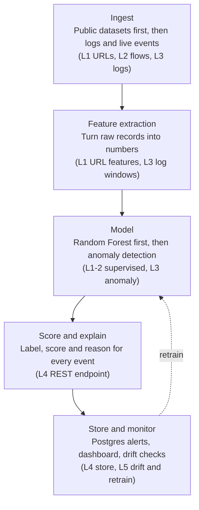

# Architecture

SentinelML is one pipeline that grows: each level swaps in a new data source or model while the later stages stay the same.

The model stage is the one that changes most, and in Level 5 drift checks send it back for retraining.

**Stack:** Python, pandas, scikit-learn, pytest, FastAPI, PostgreSQL, Docker and GitHub Actions. Levels 1 to 3 run as scripts and notebooks; Level 4 adds the service.
